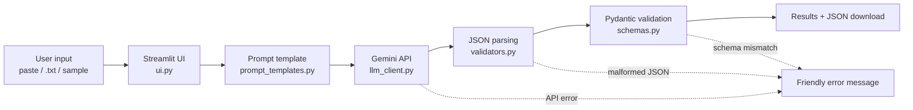

# Architecture

## Modules
| File | Responsibility |
|---|---|
| `main.py` | Loads settings, starts the UI |
| `config.py` | Reads `.env`; hides the API key |
| `errors.py` | Exceptions with user-safe messages |
| `llm_client.py` | `LLMClient` interface + `GeminiClient`; maps API errors |
| `prompt_templates.py` | Template, few-shot examples, one `DocumentSpec` per document type |
| `extractor.py` | `extract_document()` – the whole workflow |
| `schemas.py` | `Invoice`, `Resume`, `Education`, `Experience` |
| `validators.py` | `json.loads` wrapper, Pydantic validation, file decoding |
| `ui.py` | Widgets, session state, results view |

## Design decisions
- **One provider module.** Only `llm_client.py` imports Google code; add a provider by subclassing `LLMClient`.
- **Fail closed.** `ExtractionResult` can only be created after parse + validation, so the UI cannot show success for failed work.
- **Double validation.** Output is validated, dumped to JSON, and validated again before display/download.
- **No repair.** Malformed JSON is rejected, never patched with regex.
- **Stale-state protection.** Starting a new extraction, switching type, or clearing input resets previous results/errors.
- Gemini's JSON mode (`response_mime_type="application/json"`) is used, with `temperature=0`, but the app never trusts it without validating.
