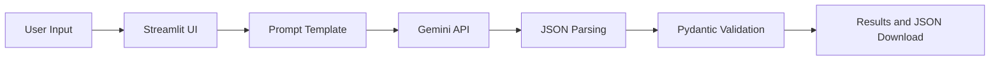

# Learning Guide

Written for beginners. Read it with the code open beside you.

## 1. What problem does the project solve?
People get invoices and resumes as plain text. A computer program wants clearly labelled fields. This project turns the first into the second using AI, and **checks** the result.

## 2. What is unstructured text?
Text with no fixed layout: "Total due is 9,145 rupees, thanks!" You can read it, but a program can't easily find the total.

## 3. What is structured data?
Data with named fields and types: `{"total_amount": 9145.0, "currency": "INR"}`.

## 4. What is an LLM?
A Large Language Model (like Gemini) is an AI trained on huge amounts of text. Given text, it predicts useful text back. It is flexible, but it can make mistakes.

## 5. What is an API?
A way for one program to talk to another over the internet. We send a request (our prompt) and get a response (the JSON). An **API key** is the password that identifies us.

## 6. How does Python talk to Gemini?
`app/llm_client.py` uses Google's official `google-genai` package:
```python
client = genai.Client(api_key=api_key)
response = client.models.generate_content(model="gemini-2.5-flash", contents=prompt, config=...)
text = response.text
```
The config asks for `application/json` output and `temperature=0` (least random).

## 7. What is prompt engineering?
Writing instructions so the model behaves reliably: say exactly what to do, what format to use, and what *not* to do (never invent facts).

## 8. What are parameterized prompt templates?
One prompt with blanks, filled in per request (`prompt_templates.py`):
```python
PROMPT_TEMPLATE = "... {required_fields} ... <document>{document_text}</document>"
prompt = build_prompt(INVOICE_SPEC, text)
```
Benefits: the same wording every time, one place to improve it, and the UI contains no prompt text.

## 9. How does few-shot prompting work?
We include worked examples (input → correct JSON) in the prompt. The model copies the pattern, so field names, date style (`YYYY-MM-DD`), and `null` handling become more consistent. We include two per document type, one showing missing values.

## 10. Why is JSON useful?
Every language can read it, it has clear types (string, number, list, null), and it can be saved as a `.json` file.

## 11. How does JSON parsing work?
`json.loads(text)` turns a JSON string into a Python dict, or raises an error if the text is broken. In `validators.py`:
```python
def parse_json_response(raw):
    data = json.loads(raw)          # raises on malformed JSON
    if not isinstance(data, dict): ...  # must be an object
```
We do **not** try to "fix" bad JSON; we reject it.

## 12. What does Pydantic do?
You describe the data as a class; Pydantic checks real data against it.
```python
class Invoice(BaseModel):
    invoice_date: date | None
    total_amount: Decimal | None
```

## 13. How does schema validation work?
`Invoice.model_validate(data)` checks that every key exists, types match, dates are real, amounts are ≥ 0, currency is 3 capital letters, and no extra keys appear. Failures raise `ValidationError`, which we turn into short readable lines such as `invoice_date: Input should be a valid date`.

**Important:** Pydantic checks *structure*, not *truth*. If the AI says the total is 500 but the document says 900, Pydantic cannot know. Always review results.

## 14. How does invoice extraction work?
Choose Invoice → `INVOICE_SPEC` supplies fields, rules, schema and examples → prompt → Gemini → JSON → `Invoice` model. A missing total is `null`; a real zero is `0.0`, so "unknown" and "zero" stay different.

## 15. How does resume extraction work?
Same flow with `RESUME_SPEC` and the `Resume` model. `education` and `experience` are lists of nested objects (`Education`, `Experience`). Email is checked with `EmailStr`. The prompt forbids guessing skills.

## 16. How does the Streamlit interface work?
Streamlit re-runs your script from top to bottom on every click. `st.session_state` remembers values between runs. Buttons use callbacks (`on_click=`) for simple actions; the Extract button calls `run_extraction()`. The app has two views: `input` and `results`.

## 17. What does each file do?
See the table in `docs/ARCHITECTURE.md`.

## 18. How does data travel?
1. User text → `validate_input_text` (not empty, not too long)
2. `build_prompt` fills the template
3. `GeminiClient.generate_json` returns raw text
4. `parse_json_response` → dict
5. `validate_data` → Pydantic model (validated twice)
6. `ExtractionResult` → UI shows summary, JSON, download button



## 19. How are errors handled?
All expected problems raise a subclass of `AppError` (in `errors.py`) with a safe `user_message`. The UI catches `AppError` and shows it; stack traces and keys are never shown.

**What if the AI returns invalid data?** Bad JSON → `ResponseFormatError`. Good JSON with wrong fields/types → `SchemaValidationError` (details listed in an expander). In both cases no result is stored, no success message appears, no download is offered, and your text stays in the box so you can retry.

## 20. How do automated tests work?
`pytest` runs functions starting with `test_`. We replace Gemini with a `FakeClient` that returns a fixed string, so tests are fast and free:
```python
result = extract_document("invoice", "text", FakeClient(INVOICE_JSON))
assert result.data["invoice_number"] == "NW-2024-0457"
```
Run: `python -m pytest -q`.

## 21. How does `.env` work?
A text file of `NAME=value` lines. `load_dotenv()` copies them into environment variables; `os.environ` reads them. It is git-ignored so your key is never uploaded. `.env.example` is the safe template.

## 22. How do I add a new extraction field?
1. Add the field to the model in `schemas.py` (e.g. `due_date: date | None`).
2. Add it to `required_fields` and `output_schema` in the spec in `prompt_templates.py`.
3. Update the few-shot example outputs and `examples/expected_*.json`.
4. Add a test case.

## 23. How do I add another document type?
1. Create a Pydantic model in `schemas.py`.
2. Create a `DocumentSpec` (fields, instructions, schema, examples) in `prompt_templates.py` and add it to `DOCUMENT_SPECS`.
3. The radio button, workflow, and validation pick it up automatically. Add a sample file and tests.

## 24. How could the project improve?
PDF input, a retry that tells the model what failed, more providers (subclass `LLMClient`), batch uploads, per-field evidence quotes, and saving results.
