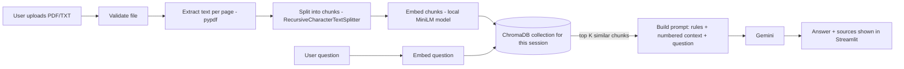

# Task 2 - Document Q&A Assistant (RAG)

Upload PDF or TXT files, ask questions in plain English, and get answers that
come **only from your documents**, with the source file and page shown for every
answer. Built with Python, Streamlit, LangChain, ChromaDB, a local
sentence-transformers embedding model, and Google Gemini.

> Part of the Datheon Python + Generative AI & LangChain Internship.
> Task 1 (Structured JSON Extractor) lives in its own folder in the same repository.

## Features

- Upload several PDF/TXT files in one session
- Validates file type, size, empty files, binary files, corrupted PDFs, password-protected PDFs
- Detects scanned PDFs with no text and explains that OCR is needed
- Recursive chunking with configurable size and overlap; keeps filename + page number per chunk
- Local embeddings (no embedding API cost) stored in ChromaDB
- Skips re-embedding a file you already processed (matched by content hash)
- Each browser session gets its **own** Chroma collection, so sessions never mix
- "Remove document" and "Reset all" really delete the vectors
- Gemini answers using **only** retrieved text; says so when the documents do not contain the answer
- Expandable source passages under every answer; citations `[1]` map to real retrieved chunks
- Friendly messages for missing API key, rate limits, bad key, wrong model name, network errors
- 60 automated tests that use fake embeddings and a fake model (no paid calls)

## Technology stack

| Part | Tool |
|------|------|
| UI | Streamlit |
| RAG framework | LangChain (`langchain-core`, `langchain-text-splitters`, `langchain-chroma`) |
| Answer model | Google Gemini via `langchain-google-genai` (default `gemini-3.5-flash-lite`) |
| Embeddings | `sentence-transformers/all-MiniLM-L6-v2` via `langchain-huggingface` (runs locally) |
| Vector database | ChromaDB (stored in `chroma_db/`) |
| PDF reading | pypdf |
| Config / validation | python-dotenv, Pydantic |
| Tests | pytest |

## Architecture



## The RAG workflow in simple English

1. **Prepare (once per document):** the app reads the text, cuts it into small
   overlapping pieces called *chunks*, turns each chunk into a list of numbers
   (an *embedding*), and saves the numbers plus the original text in ChromaDB.
2. **Retrieve (every question):** your question is turned into numbers the same
   way. ChromaDB finds the chunks whose numbers are closest, which means closest
   in meaning.
3. **Generate:** those chunks are pasted into a prompt that tells Gemini "answer
   only from this text, or say you cannot". Gemini writes the answer.
4. **Show sources:** the app lists the chunks it retrieved, with file and page.

More detail: [`docs/RAG_EXPLAINED.md`](docs/RAG_EXPLAINED.md).

## Folder structure

```
Task-2-Document-QA-RAG/
├── app/
│   ├── main.py            Streamlit user interface
│   ├── config.py          Reads settings from .env
│   ├── document_loader.py Validates and reads PDF/TXT
│   ├── text_splitter.py   Chunking
│   ├── embeddings.py      Loads the local embedding model
│   ├── vector_store.py    ChromaDB wrapper (one collection per session)
│   ├── retriever.py       Finds the top-K chunks
│   ├── ingestion.py       Load -> split -> embed -> store for one file
│   ├── rag_chain.py       Retrieve -> prompt -> Gemini -> Answer
│   ├── prompts.py         All prompt text
│   └── utils.py           Errors and small helpers
├── tests/                 pytest tests
├── sample_documents/      Safe example files + example questions
├── docs/                  Teaching and setup guides
├── run.py                 Optional launcher (python run.py)
├── .env.example           Settings template (placeholders only)
├── .gitignore
├── pytest.ini
├── requirements.txt
└── README.md
```

`ingestion.py` is the one file added beyond the suggested layout; it keeps the UI
file free of processing logic.

## Requirements

- Windows 10/11 (also works on macOS/Linux), Python 3.10 - 3.13
- About 2 GB free disk space (PyTorch is large)
- Internet for: installing packages, the one-time embedding-model download
  (~90 MB), and every Gemini answer
- A free Gemini API key: <https://aistudio.google.com/apikey>

## Windows setup (Command Prompt)

Full step-by-step version: [`docs/RUN_GUIDE_WINDOWS.md`](docs/RUN_GUIDE_WINDOWS.md).

```bat
cd %USERPROFILE%\Downloads
tar -xf Task-2-Document-QA-RAG.zip
cd Task-2-Document-QA-RAG
python -m venv .venv
.venv\Scripts\activate
python -m pip install --upgrade pip
pip install -r requirements.txt
copy .env.example .env
notepad .env
```

In Notepad, replace `your_gemini_api_key_here` with your key, save, close. Then:

```bat
python -m streamlit run app/main.py
```

A browser tab opens at <http://localhost:8501>. Stop the app with `Ctrl+C`.

## Configuration (`.env`)

| Setting | Meaning | Default |
|---------|---------|---------|
| `GEMINI_API_KEY` | Your key. Required for answers. | placeholder |
| `GEMINI_MODEL` | Gemini model name. Names change; check the Gemini models page. | `gemini-3.5-flash-lite` |
| `EMBEDDING_MODEL` | Local embedding model. | `sentence-transformers/all-MiniLM-L6-v2` |
| `CHUNK_SIZE` | Characters per chunk. | `1000` |
| `CHUNK_OVERLAP` | Characters shared by neighbouring chunks. | `150` |
| `TOP_K` | Chunks retrieved per question. | `4` |
| `MAX_FILE_SIZE_MB` | Upload limit per file. | `10` |
| `CHROMA_DIR` | Folder for the local vector DB. | `chroma_db` |

Invalid numbers fall back to defaults. If you change `EMBEDDING_MODEL`, click
**Reset all** and process your files again (vectors from different models cannot be mixed).

## Using the app

1. Upload files in the sidebar (try the ones in `sample_documents/`).
2. Click **Process documents**. The first run downloads the embedding model.
3. Type a question at the bottom and press Enter.
4. Open **Sources** under the answer to read the exact passages used.
5. **Clear chat** keeps documents. **Reset all** deletes documents, vectors and chat.

Example questions are in [`sample_documents/README.md`](sample_documents/README.md).

## Running the tests

```bat
.venv\Scripts\activate
python -m pytest
```

Tests do not need an API key or internet. They use a fake embedding model and a
fake chat model. (A test run with the real Gemini API needs your own key and is
not included.)

## Common errors and fixes

| Message / problem | Fix |
|-------------------|-----|
| `'python' is not recognized` | Install Python from python.org and tick **Add python.exe to PATH**; reopen Command Prompt. |
| `No module named 'app'` | Run commands from inside the `Task-2-Document-QA-RAG` folder. |
| "Gemini API key not set" banner | Check `.env` exists (not `.env.txt`), has your key, then restart the app. |
| "Gemini rejected the API key" | Key typed wrongly or revoked; create a new one. |
| "rate limit or quota" | Wait a minute; free tiers have per-minute and daily limits. |
| "could not find the model" | Update `GEMINI_MODEL` to a current name from the Gemini models page. |
| "Could not load the embedding model" | Needs internet on first run; retry. |
| "No extractable text" | The PDF is scanned images; OCR is not included. |
| Port already in use | `python -m streamlit run app/main.py --server.port 8502` |

## API usage and rate limits

- Embeddings: local, free, no limits.
- Each question makes **one** Gemini call containing the question and `TOP_K` chunks.
- Free-tier keys have rate and daily limits that Google can change; see the
  Gemini rate-limits page. The app retries twice automatically, then shows a friendly message.
- Lower `TOP_K` or `CHUNK_SIZE` to send fewer tokens per question.

## Privacy and security

- The API key is read from `.env`, never hard-coded, never printed, never shown in the UI.
  `.env` is in `.gitignore`; only `.env.example` (placeholders) is committed.
- Embedding happens locally, **but the question and the retrieved document passages are
  sent to Google's Gemini API** to write each answer. The documents are therefore not
  fully private. Do not upload confidential material you are not allowed to share with Google.
- Google's terms for free-tier usage may allow use of content to improve their products; check the current terms.
- Vectors and chunk text are stored unencrypted in `chroma_db/` on your computer
  (ignored by Git). Use **Reset all** or `python run.py --clean` to delete them.
- Uploaded files are processed in memory and are not saved to disk.
- Text inside documents is treated as data; the prompt tells the model to ignore instructions found in documents
  (this reduces, but cannot fully remove, prompt-injection risk).

## Adding Task 2 to your existing GitHub repository

Short version below; careful explanation in [`docs/RUN_GUIDE_WINDOWS.md`](docs/RUN_GUIDE_WINDOWS.md#adding-task-2-to-github).

```bat
cd path\to\your\existing\repo
git status
dir
```

Copy the whole `Task-2-Document-QA-RAG` folder next to your Task 1 folder, then:

```bat
git status
git add Task-2-Document-QA-RAG
git status
git commit -m "Add Task 2: Document Q&A Assistant (RAG)"
git push
```

Check `git status` shows **no** `.env` before committing.

## Known limitations and ideas

- No OCR for scanned PDFs (could add Tesseract).
- Each question is answered on its own; follow-up questions like "and what about it?" are not understood because chat history is not sent to retrieval.
- Tables and multi-column PDFs may extract in a jumbled order.
- Chroma data from closed sessions stays in `chroma_db/` until you run `python run.py --clean`.
- Distance values are shown, but there is no minimum-similarity cutoff; the model decides if the text is sufficient.
- Future: DOCX support, hybrid keyword + vector search, reranking, streaming answers, conversation memory.
